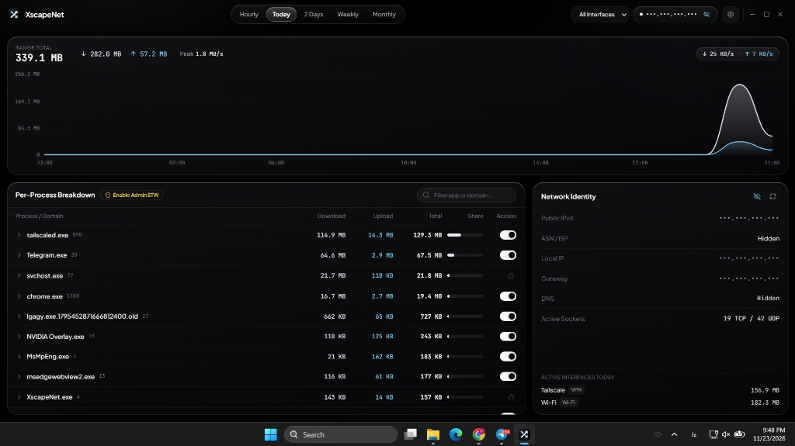
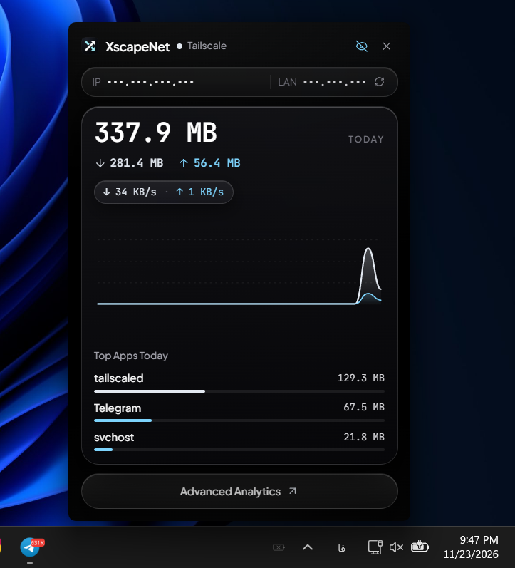
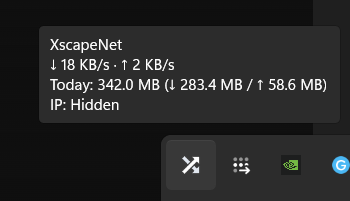
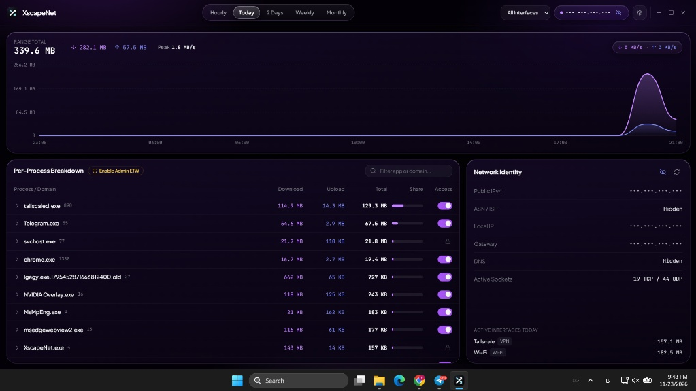
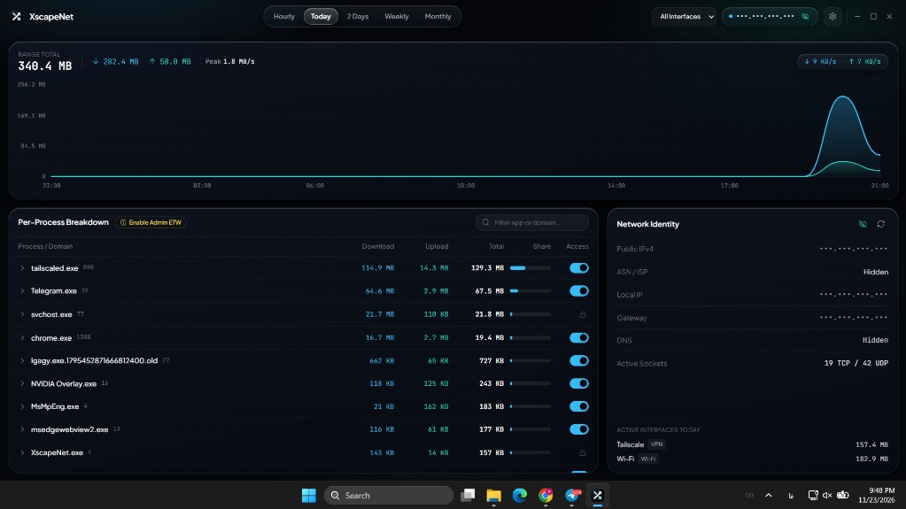
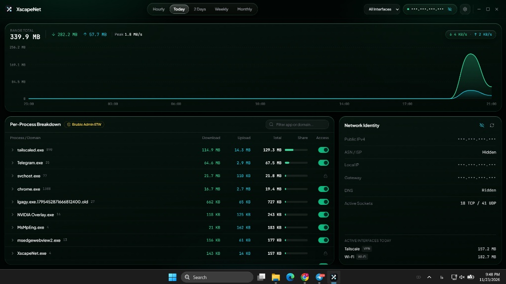

<div dir="rtl" align="center">
  
  <h1>XscapeNet</h1>
  <p>
    <strong>مانیتور بومی و فوق‌سبک مصرف اینترنت ویندوز، تفکیک ریز مصرف و فایروال اختصاصی هر برنامه.</strong><br />
    ساخته‌شده با <strong>Rust</strong> و <strong>Tauri v2</strong> برای حداقل مصرف منابع سیستم.
  </p>

  <p>
    <a href="README.md">English</a>
    &nbsp;·&nbsp;
    <a href="README.fa.md"><strong>فارسی</strong></a>
    &nbsp;·&nbsp;
    <a href="README.zh-CN.md">简体中文</a>
  </p>

  <p>
    
    
    
    
    
  </p>
</div>

<br />

<div align="center">
  
</div>

<br />

<div dir="rtl">

## ساخته‌شده برای سرعت و سبکی، نه سنگین کردن سیستم

بیشتر ابزارهای مانیتور شبکه یا با Electron ساخته می‌شن و بالای ۳۰۰ مگابایت رم در پس‌زمینه می‌گیرن، یا ظاهر قدیمی و به‌هم‌ریخته‌ای دارن. **XscapeNet** با هسته خالص **Rust** روی APIهای بومی ویندوز (Win32 + ETW) و رابط کاربری **Dark Liquid Glass** در **Tauri v2** ساخته شده تا بی‌صدا در پس‌زمینه کار کنه و دقیق‌ترین آمار رو بده.

| | **XscapeNet** *(Rust + Tauri v2)* | **مانیتورهای رایج Electron** |
| :--- | :--- | :--- |
| **حجم فایل اجرایی** | **حدود ۶.۵ مگابایت** *(یک فایل نیتیو)* | ۱۲۰ تا ۲۵۰ مگابایت |
| **مصرف CPU پس‌زمینه** | **زیر ۰.۳٪** *(نمونه‌برداری ۱ ثانیه‌ای کرنل)* | ۲٪ تا ۶٪ |
| **مصرف حافظه** | WebView2 بومی ویندوز *(معلق در حالت سیستم‌تری)* | یک نسخه کامل و جداگانه از Chromium |
| **درایور کرنل** | **صفر** *(Win32 `GetIfTable2` و ETW بومی)* | اغلب نیازمند نصب Npcap یا WinDivert |
| **ذخیره‌سازی** | **SQLite WAL** *(چک‌پوینت خودکار دوره‌ای و هنگام خروج)* | فایل‌های سنگین JSON |

<br />

## نگاهی به بخش‌های برنامه

### ۱. سیستم‌تری زنده و پنجره فوری مصرف امروز (Today Popover)

XscapeNet بی‌سروصدا در System Tray ویندوز می‌شینه. با بردن موس روی آیکون، سرعت لحظه‌ای دانلود و آپلود، کل مصرف امروز و وضعیت IP رو می‌بینی (`Hidden` در حالت حریم خصوصی). با یک کلیک چپ، پنجره جمع‌وجور **Today Popover** بالای تسک‌بار باز می‌شه و مصرف امروز، سرعت زنده، نمودار ۲۴ ساعته و ۳ برنامه پرمصرف رو نشون می‌ده.

<div align="center">
  <table>
    <tr>
      <td align="center" width="58%">
        
        <br />
        <sub><strong>Today Popover</strong> — مصرف امروز، سرعت لحظه‌ای، نمودار ۲۴ ساعته و برنامه‌های پرمصرف</sub>
      </td>
      <td align="center" width="42%">
        
        <br />
        <sub><strong>سیستم‌تری زنده</strong> — آیکون وکتور پرکنتراست و نمایش لحظه‌ای آمار</sub>
      </td>
    </tr>
  </table>
</div>

<br />

### ۲. داشبورد پیشرفته، ریز مصرف ETW و سوییچ قطع/وصل نت برنامه‌ها

با باز کردن **Advanced Analytics** کنترل کامل شبکه در اختیارت قرار می‌گیره:

* **بازه‌های زمانی چندسطحی** — جابه‌جایی آنی بین **Hourly (ساعتی)**، **Today (امروز)**، **2 Days (۲ روزه)**، **Weekly (هفتگی)** و **Monthly (ماهانه)** و فیلتر جداگانه برای هر کارت شبکه (`Wi-Fi`، `Ethernet`، `Tailscale / VPN`).
* **تفکیک دقیق برنامه و دامنه** — شنود مستقیم رویدادهای **Windows ETW** (`Microsoft-Windows-Kernel-Network` و `Microsoft-Windows-DNS-Client`) برای نمایش دقیق حجم مصرفی هر برنامه، دامنه‌های مقصد و پروتکل (`HTTPS`، `QUIC`، `TCP`، `UDP`، `DNS`).
* **سوییچ قطع و وصل اینترنت هر برنامه (`Access`)** — با یک سوییچ کشویی تمیز می‌تونی اینترنت هر برنامه رو از طریق قوانین استاندارد و قابل‌برگشت Windows Defender Firewall قطع یا دوباره وصل کنی. پراسس‌های حیاتی ویندوز (`svchost.exe`، `System`، `lsass.exe` و...) به‌صورت خودکار قفل شدن تا شبکه سیستم آسیب نبینه.
* **هویت شبکه و حالت حریم خصوصی (Hide IP)** — نمایش Public IPv4، کشور، ASN/ISP، Local IP، Gateway، DNS، سوکت‌های فعال و مصرف روزانه هر اینترفیس؛ به همراه دکمه **Hide IP** برای مخفی کردن آنی آی‌پی‌ها و دامنه‌ها در کل اپ و سیستم‌تری.

<br />

### ۳. چهار تم تیره و هماهنگ Liquid Glass

هر تم کل سیستم بصری — عمق شیشه، نور لبه، رنگ نمودار، نوارها و سوییچ‌ها — رو به‌صورت یکپارچه تغییر می‌ده و پیش‌فرض روی **OLED Black** (`#000000`) تنظیم شده:

<div align="center">
  <table>
    <tr>
      <td align="center" width="50%">
        
        <br />
        <sub><strong>OLED Black</strong> <em>(پیش‌فرض)</em> — سیاه خالص <code>#000000</code> مونوکروم</sub>
      </td>
      <td align="center" width="50%">
        
        <br />
        <sub><strong>Midnight Violet</strong> — بنفش تیره و شیشه‌ای عمیق</sub>
      </td>
    </tr>
    <tr>
      <td align="center" width="50%">
        
        <br />
        <sub><strong>Obsidian Slate</strong> — گرافیتی تیره با آبی یخی</sub>
      </td>
      <td align="center" width="50%">
        
        <br />
        <sub><strong>Emerald Noir</strong> — سبز زمردی تیره</sub>
      </td>
    </tr>
  </table>
</div>

<br />

## جزئیات فنی و معماری

<details>
<summary><strong>مشاهده ساختار پروژه و تضمین‌های مهندسی ویندوز</strong></summary>

<br />

* **بدون شمارش تکراری**: حذف خودکار Loopback و مینی‌پورت‌های فیلتر NDIS در سطح `MIB_IF_ROW2` تا ترافیک کارت شبکه اصلی و تونل‌های VPN جدا و دقیق ثبت بشن.
* **دیتابیس ایمن در برابر بسته شدن**: ذخیره دائمی آمار، تنظیمات و لیست برنامه‌های مسدودشده در `%LOCALAPPDATA%\XscapeNet\xscapenet.db` با حالت **SQLite WAL** و چک‌پوینت خودکار دوره‌ای و هنگام خروج.
* **اجرای خودکار با ویندوز (Run on Startup)**: استفاده از Windows Task Scheduler (`/RL HIGHEST`) در حالت ادمین و Fallback تمیز روی رجیستری `HKCU\Run` در حالت عادی.

</details>

<br />

## بیلد از سورس (ویندوز ۱۰ و ۱۱)

</div>

```powershell
git clone https://github.com/nexouya/XscapeNet.git
cd XscapeNet
npm install

# اجرا در حالت توسعه
npm run tauri dev

# ساخت فایل اجرایی و نصاب ویندوز (.exe / .msi)
npm run tauri build
```

---

<div align="center">
  <sub>MIT License · Built with Rust &amp; Tauri v2</sub>
</div>
