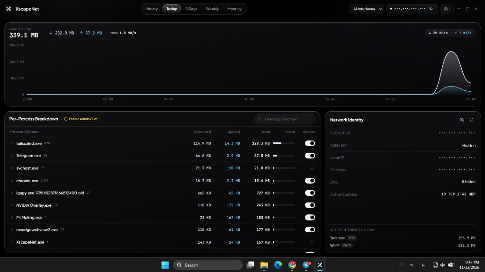
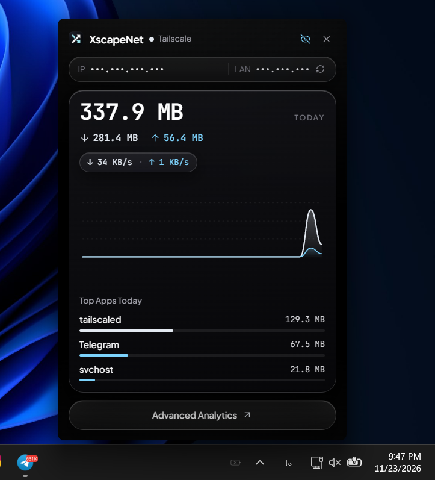
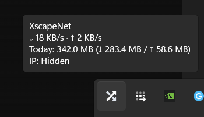
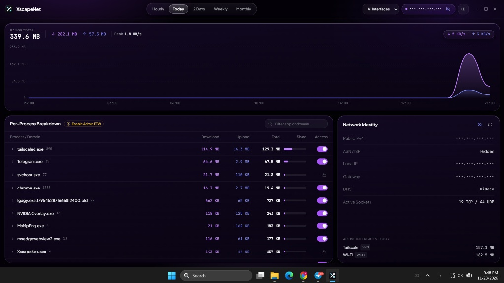
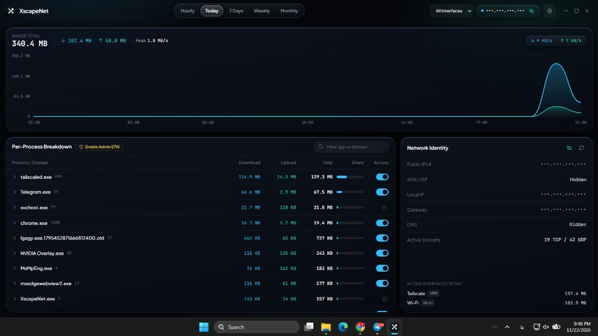
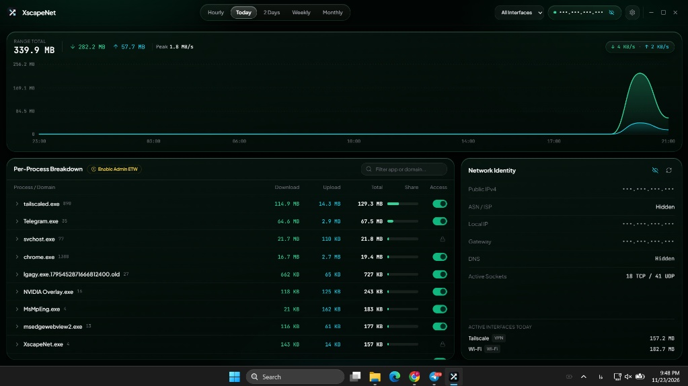

<div align="center">
  
  <h1>XscapeNet</h1>
  <p>
    <strong>Native Windows network monitor, traffic attribution engine, and per-app firewall.</strong><br />
    Built in <strong>Rust</strong> and <strong>Tauri v2</strong> for near-zero overhead.
  </p>

  <p>
    <a href="README.md"><strong>English</strong></a>
    &nbsp;·&nbsp;
    <a href="README.fa.md">فارسی</a>
    &nbsp;·&nbsp;
    <a href="README.zh-CN.md">简体中文</a>
  </p>

  <p>
    
    
    
    
    
  </p>
</div>

<br />

<div align="center">
  
</div>

<br />

## Built for Speed, Not Bloat

Most desktop network monitors either wrap a full Electron browser eating 300+ MB of RAM in the background, or feel stuck in Windows Vista. **XscapeNet** runs a pure Rust telemetry backend against native Win32 & ETW APIs, paired with a GPU-composited Dark Liquid Glass interface in Tauri v2.

| | **XscapeNet** *(Rust + Tauri v2)* | **Typical Electron Monitor** |
| :--- | :--- | :--- |
| **Binary Footprint** | **~6.5 MB** single native executable | 120 – 250 MB |
| **Background CPU** | **< 0.3%** *(1s kernel counter polling)* | 2% – 6% |
| **Memory Profile** | Native OS WebView2 *(suspended when minimized to tray)* | Dedicated Chromium instance |
| **Kernel Drivers** | **None** *(native Win32 `GetIfTable2` + ETW)* | Often requires Npcap / WinDivert |
| **Persistence** | **SQLite WAL** *(automatic periodic & on-exit checkpoints)* | Flat JSON / heavy local stores |

<br />

## Tour of the Interface

### 1. System Tray & Instant Today Popover

XscapeNet stays silently anchored in your Windows system tray. Hovering over the crisp monochrome tray glyph surfaces live download/upload speed, today's total traffic, and IP status (`Hidden` when Privacy Mode is active). A single left-click opens the compact **Today Popover** directly above your taskbar with live rates, a 24-hour sparkline, and your top 3 apps.

<div align="center">
  <table>
    <tr>
      <td align="center" width="58%">
        
        <br />
        <sub><strong>Today Popover</strong> — Daily total, live rate pill, 24h curve &amp; top apps</sub>
      </td>
      <td align="center" width="42%">
        
        <br />
        <sub><strong>System Tray</strong> — High-contrast vector icon &amp; live tooltip</sub>
      </td>
    </tr>
  </table>
</div>

<br />

### 2. Advanced Analytics, ETW Attribution & Per-App Firewall

Opening **Advanced Analytics** unlocks full historical inspection and network control without visual clutter:

* **Multi-Resolution Time Ranges** — Switch seamlessly between **Hourly**, **Today**, **2 Days**, **Weekly**, and **Monthly** views, or isolate individual adapters (`Wi-Fi`, `Ethernet`, `Tailscale / VPN`).
* **Per-Process & Domain Attribution** — Subscribes directly to Windows **ETW** (`Microsoft-Windows-Kernel-Network` + `Microsoft-Windows-DNS-Client`) to attribute exact bytes per process, remote domain, and protocol (`HTTPS`, `QUIC`, `TCP`, `UDP`, `DNS`).
* **One-Click Per-App Kill Switch (`Access`)** — Block or restore internet access for any application via deterministic, reversible Windows Defender Firewall rules. Critical OS processes (`svchost.exe`, `System`, `lsass.exe`, etc.) are automatically locked for safety.
* **Network Identity & Privacy Mode** — View Public IPv4, Country, ASN/ISP, Local IP, Gateway, DNS, active TCP/UDP sockets, and per-interface daily totals. Toggle the **Eye** button anytime to mask all IPs and domains across both windows and the tray tooltip.

<br />

### 3. Four Harmonized Dark Liquid Glass Themes

Every theme adapts the entire visual system — glass depth, specular rim highlights, chart gradients, progress bars, and switches — while defaulting to pure `#000000` **OLED Black**:

<div align="center">
  <table>
    <tr>
      <td align="center" width="50%">
        
        <br />
        <sub><strong>OLED Black</strong> <em>(Default)</em> — Pure <code>#000000</code> monochrome precision</sub>
      </td>
      <td align="center" width="50%">
        
        <br />
        <sub><strong>Midnight Violet</strong> — Deep dark royal-amethyst glass</sub>
      </td>
    </tr>
    <tr>
      <td align="center" width="50%">
        
        <br />
        <sub><strong>Obsidian Slate</strong> — Graphite glass with cool ice-cyan accents</sub>
      </td>
      <td align="center" width="50%">
        
        <br />
        <sub><strong>Emerald Noir</strong> — Pitch black-emerald &amp; jade accents</sub>
      </td>
    </tr>
  </table>
</div>

<br />

## Architecture & Engineering Notes

<details>
<summary><strong>Click to inspect project structure &amp; low-level Windows guarantees</strong></summary>

<br />

```text
xscapenet/
├── src/                         # React + TypeScript + Tailwind (GPU Dark Liquid Glass UI)
│   ├── components/              # PopoverView, AdvancedView, TrafficChart, SettingsModal
│   └── lib/                     # Tauri v2 IPC bridge & live 1s event stream
└── src-tauri/src/               # Pure Rust Windows telemetry & OS integration
    ├── collector_win.rs         # Win32 GetIfTable2 (64-bit counters) + ETW Kernel-Network & DNS
    ├── firewall.rs              # Reversible per-app Windows Defender Firewall rule engine
    ├── storage.rs               # SQLite WAL multi-resolution rollups (minutely / hourly / daily)
    ├── ip_info.rs               # Win32 GetAdaptersAddresses + smart Public IP / ASN resolver
    ├── startup.rs               # Windows Task Scheduler (/RL HIGHEST) + HKCU\Run fallback
    └── tray.rs                  # Native System Tray icon, live tooltip & popover positioning
```

* **Zero Double-Counting**: Filters out software loopback and NDIS filter miniports at the `MIB_IF_ROW2` level so physical NICs (`Wi-Fi`, `Ethernet`) and VPN tunnels (`Tailscale`, `WireGuard`, `WinTun`) are tracked cleanly without inflated totals.
* **Crash-Safe SQLite WAL**: All traffic rollups, preferences, and firewall states live in `%LOCALAPPDATA%\XscapeNet\xscapenet.db` with periodic and on-exit `PRAGMA wal_checkpoint(TRUNCATE)` flushes.
* **Dual-Mode Startup & Privileges**: Runs cleanly as a standard user (exact interface totals + active sockets) and supports one-click **Enable Admin ETW** for per-process kernel telemetry and firewall blocking. **Run on Windows Startup** uses Windows Task Scheduler (`/RL HIGHEST`) when elevated and falls back to `HKCU\...\Run` otherwise.

</details>

<br />

## Build from Source

Requires **Windows 10/11**, [Rust](https://rustup.rs/) (stable), [Node.js 18+](https://nodejs.org/), and Microsoft C++ Build Tools (WebView2 is pre-installed on Windows 11).

```powershell
git clone https://github.com/nexouya/XscapeNet.git
cd XscapeNet
npm install

# Run in development mode
npm run tauri dev

# Build optimized release binary & Windows installers (.exe / .msi)
npm run tauri build
```

---

<div align="center">
  <sub>MIT License · Built with Rust &amp; Tauri v2</sub>
</div>
