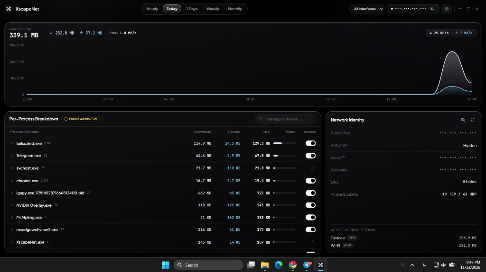
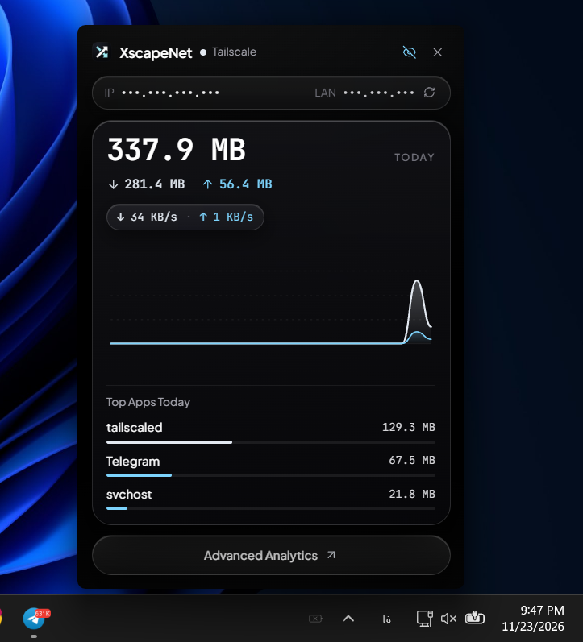
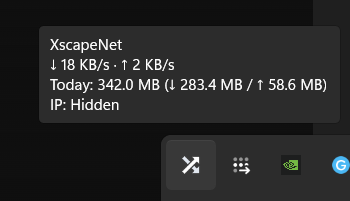
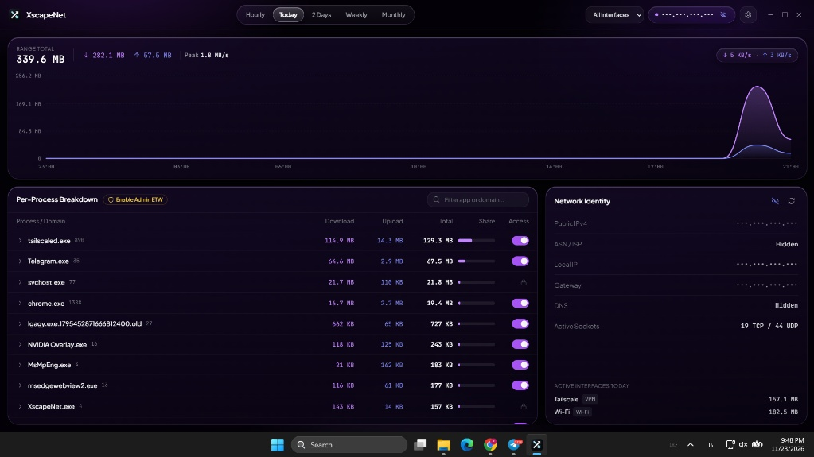
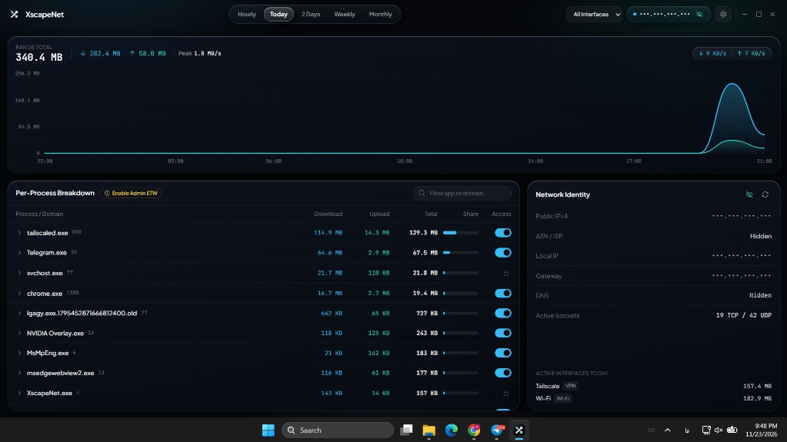
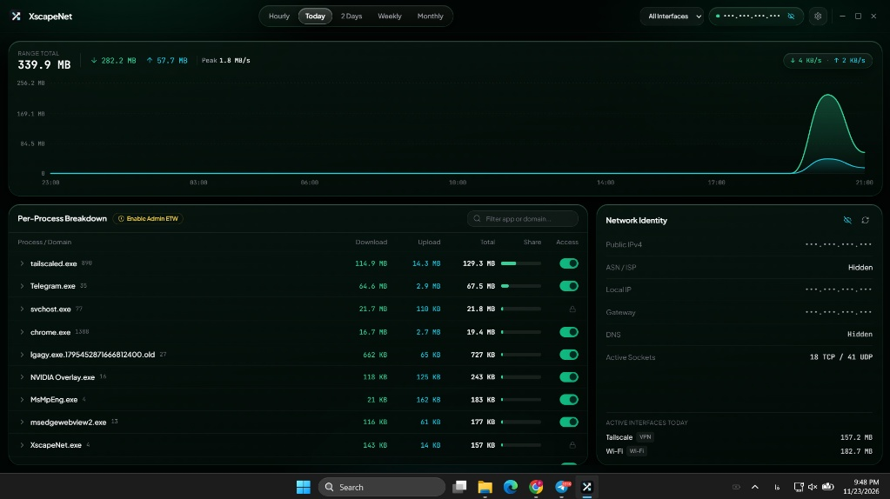

<div align="center">
  
  <h1>XscapeNet</h1>
  <p>
    <strong>原生轻量级 Windows 网络流量监控、进程级流量归因与单应用防火墙。</strong><br />
    基于 <strong>Rust</strong> 与 <strong>Tauri v2</strong> 构建，极致低开销。
  </p>

  <p>
    <a href="README.md">English</a>
    &nbsp;·&nbsp;
    <a href="README.fa.md">فارسی</a>
    &nbsp;·&nbsp;
    <a href="README.zh-CN.md"><strong>简体中文</strong></a>
  </p>

  <p>
    
    
    
    
    
  </p>
</div>

<br />

<div align="center">
  
</div>

<br />

## 为效率而生，拒绝臃肿

多数桌面网络监控软件捆绑了完整的 Electron 运行时，后台常驻动辄占用 300 MB 以上内存。**XscapeNet** 使用纯 **Rust** 调用 Windows 原生 Win32 与 ETW 接口，搭配 **Tauri v2** GPU 合成暗黑液态玻璃界面，常驻后台几乎零负担。

| | **XscapeNet** *(Rust + Tauri v2)* | **常见 Electron 监控工具** |
| :--- | :--- | :--- |
| **二进制体积** | **约 6.5 MB** *(单一原生可执行文件)* | 120 – 250 MB |
| **后台 CPU 占用** | **< 0.3%** *(1 秒内核计数器采样)* | 2% – 6% |
| **内存占用** | 系统原生 WebView2 *(最小化至托盘后自动休眠)* | 内置完整 Chromium 实例 |
| **内核驱动** | **零驱动** *(原生 Win32 `GetIfTable2` + ETW)* | 通常需安装 Npcap / WinDivert |
| **数据持久化** | **SQLite WAL** *(定期与退出自动 Checkpoint)* | 臃肿 JSON / 重型本地库 |

<br />

## 界面与核心功能

### 1. 系统托盘与今日速览浮窗（Today Popover）

XscapeNet 静默驻留在 Windows 系统托盘中。悬停高对比度托盘图标即可查看实时上下行速率、今日总流量与 IP 状态（隐私模式下自动显示 `Hidden`）。左键单击即可在任务栏上方唤出紧凑的 **Today Popover**，一眼掌握今日总量、实时速率、24 小时曲线及前三耗流应用。

<div align="center">
  <table>
    <tr>
      <td align="center" width="58%">
        
        <br />
        <sub><strong>Today Popover</strong> — 今日总流量、实时速率、24 小时迷你曲线与热门应用</sub>
      </td>
      <td align="center" width="42%">
        
        <br />
        <sub><strong>系统托盘</strong> — 高对比度矢量图标与实时悬浮提示</sub>
      </td>
    </tr>
  </table>
</div>

<br />

### 2. 高级流量分析、ETW 归因与单应用防火墙

点击 **Advanced Analytics** 进入完整分析面板：

* **多尺度时间视图** — 支持 **Hourly**、**Today**、**2 Days**、**Weekly** 与 **Monthly** 无缝切换，并可按单个网卡（`Wi-Fi`、`Ethernet`、`Tailscale / VPN`）精确过滤。
* **进程与域名级统计** — 直接订阅 Windows **ETW**（`Microsoft-Windows-Kernel-Network` 与 `Microsoft-Windows-DNS-Client`），展开任意进程即可查看目标域名、协议标签（`HTTPS`、`QUIC`、`TCP`、`UDP`、`DNS`）及精确字节数。
* **一键单应用断网开关（`Access`）** — 通过可逆的 Windows Defender 防火墙规则一键阻断或恢复任意用户应用联网；系统核心进程（`svchost.exe`、`System`、`lsass.exe` 等）自动锁定保护，防止误操作。
* **网络身份与隐私模式** — 集中展示公网 IPv4、国家/地区、ASN/ISP、局域网 IP、网关、DNS、活跃 TCP/UDP 套接字数及各网卡当日流量；点击 **眼睛按钮** 即可一键隐藏全部敏感地址与域名。

<br />

### 3. 四套协调暗黑液态玻璃主题

每套主题均整体联动玻璃通透度、边缘高光、图表曲线、进度条与开关配色，默认采用纯黑 `#000000` **OLED Black**：

<div align="center">
  <table>
    <tr>
      <td align="center" width="50%">
        
        <br />
        <sub><strong>OLED Black</strong> <em>（默认）</em> — 纯黑 <code>#000000</code> 极简单色</sub>
      </td>
      <td align="center" width="50%">
        
        <br />
        <sub><strong>Midnight Violet</strong> — 深邃暗紫液态玻璃</sub>
      </td>
    </tr>
    <tr>
      <td align="center" width="50%">
        
        <br />
        <sub><strong>Obsidian Slate</strong> — 黑曜石与冷冰蓝</sub>
      </td>
      <td align="center" width="50%">
        
        <br />
        <sub><strong>Emerald Noir</strong> — 暗黑翡翠绿</sub>
      </td>
    </tr>
  </table>
</div>

<br />

## 架构与工程细节

<details>
<summary><strong>展开查看项目结构与底层实现说明</strong></summary>

<br />

* **零重复计数**：在 `MIB_IF_ROW2` 层级过滤回环与 NDIS 虚拟过滤接口，精准区分物理网卡与 VPN 隧道。
* **防丢数持久化**：全部历史统计、偏好设置与拦截列表保存于 `%LOCALAPPDATA%\XscapeNet\xscapenet.db`（SQLite WAL 模式），支持定期及退出时自动执行 `PRAGMA wal_checkpoint(TRUNCATE)`。
* **开机自启与权限适配**：普通权限即开即用，管理员权限下支持 ETW 内核归因与防火墙控制，并通过 Windows 任务计划程序（`/RL HIGHEST`）或 `HKCU\Run` 实现可靠自启。

</details>

<br />

## 从源码构建

需要 **Windows 10/11**、[Rust](https://rustup.rs/)（stable）、[Node.js 18+](https://nodejs.org/) 与 Microsoft C++ Build Tools。

```powershell
git clone https://github.com/nexouya/XscapeNet.git
cd XscapeNet
npm install

# 开发模式运行
npm run tauri dev

# 构建 Release 可执行文件与 Windows 安装包（.exe / .msi）
npm run tauri build
```

---

<div align="center">
  <sub>MIT License · Built with Rust &amp; Tauri v2</sub>
</div>
